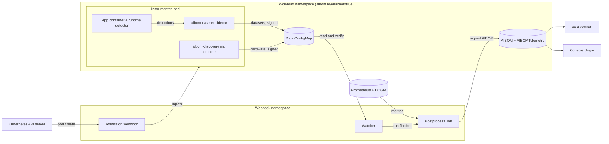

# Project AIBOM

An AI Bill of Materials (AIBOM) records what went into an AI workload run: the model, the dataset, the source code, the hardware, and how it performed. These projects collect that automatically on OpenShift and let you browse and compare the results.

| Project | What it does |
|---------|--------------|
| [**Webhook**](aibom-webhook-service/index.md) | A Kubernetes admission webhook that instruments AI workloads and compiles an `AIBOM` custom resource when each run finishes. This is where AIBOMs come from. |
| [**CLI**](oc-aibom/index.md) | `oc aibomrun`, a `kubectl`/`oc` plugin to list, filter, inspect, diff and compare AIBOMs from the terminal. |
| [**Console Plugin**](aibom-console-plugin/index.md) | An OpenShift Console plugin to browse, filter and compare AIBOMs in the web console, with telemetry charts. |

## How they fit together

1. Install the [webhook](aibom-webhook-service/user-guide/getting-started.md) and enable the namespaces whose workloads you want to track.
2. Run Jobs as usual. Each one is instrumented without changes to its manifest, and an `AIBOM` is created when it finishes.
3. Read the results with the [CLI](oc-aibom/install.md) or the [console plugin](aibom-console-plugin/guide/deployment.md). Both use your existing Kubernetes RBAC.
